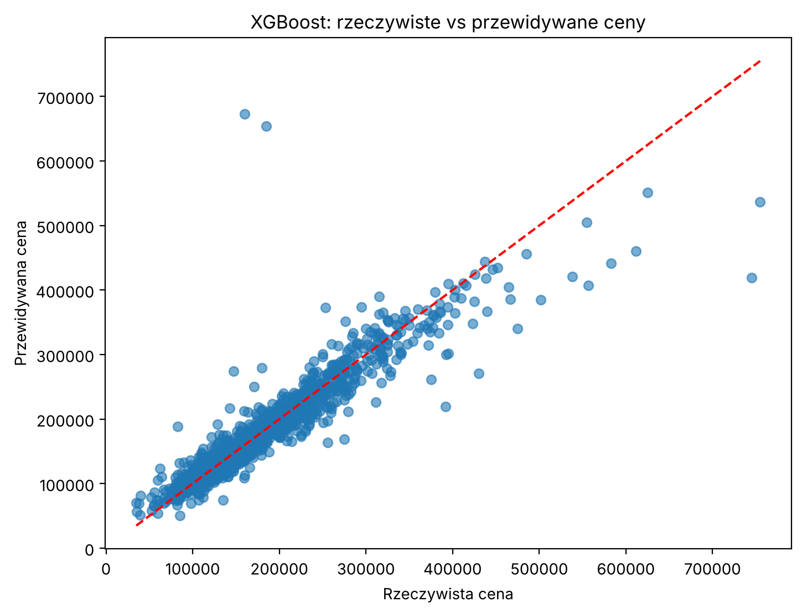

# 🏠 House Prices – Advanced Regression Techniques

Predicting sale prices of homes in Ames, Iowa – solution to the
[Kaggle competition](https://www.kaggle.com/competitions/house-prices-advanced-regression-techniques).
79 features describing almost every aspect of a house → one number: its price.

**Result: 5-fold cross-validated RMSLE ≈ 0.125** (tuned XGBoost).

## Approach

1. **Domain-driven imputation** – most missing values mean *the feature doesn't exist*
   (no pool, no garage, no basement), so they become `"None"` / `0` instead of a mean.
   `LotFrontage` is filled with the median of the house's neighborhood.
2. **Feature engineering** – total living area, total bathrooms, house / remodel / garage age,
   binary flags (`HasGarage`, `HasPool`, `Has2ndFloor`…).
3. **Leak-free preprocessing** – imputation, one-hot encoding and scaling live inside a
   scikit-learn `Pipeline`, so they are fitted only on training folds.
4. **Log-transformed target** – `TransformedTargetRegressor(log1p / expm1)`, because prices are
   right-skewed and the metric (RMSLE) works on log scale anyway.
5. **Model comparison with 5-fold CV** instead of a single train/validation split.
6. **Hyperparameter tuning** of the best model with `RandomizedSearchCV`.

## Results (5-fold CV)

| Model | Train RMSLE | Validation RMSLE |
|---|---|---|
| **XGBoost (tuned)** | – | **0.1247** |
| XGBoost | 0.0903 | 0.1297 |
| Lasso | 0.1036 | 0.1415 |
| Random Forest | 0.0539 | 0.1426 |
| Ridge | 0.1063 | 0.1442 |
| Linear Regression | 0.0907 | 0.1733 |

Random Forest overfits the most (big train/validation gap); Lasso and Ridge are stable but weaker than boosting.



The two points far above the line are huge houses (> 4000 sq ft) sold far below market price –
known anomalies in this dataset.

## Next steps

- [ ] Drop the two partial-sale outliers from training
- [ ] Ensemble XGBoost with Lasso
- [ ] Move imputation statistics (medians/modes) inside the CV pipeline

## Run it

```bash
git clone https://github.com/lucc1to/kaggle-house-prices.git
cd kaggle-house-prices
python -m venv .venv && source .venv/bin/activate
pip install -r requirements.txt

# data: download from Kaggle and unzip into data/
kaggle competitions download -c house-prices-advanced-regression-techniques -p data
unzip data/house-prices-advanced-regression-techniques.zip -d data

jupyter notebook notebooks/house_prices.ipynb
```

## Stack
Python · pandas · NumPy · scikit-learn · XGBoost · Matplotlib
